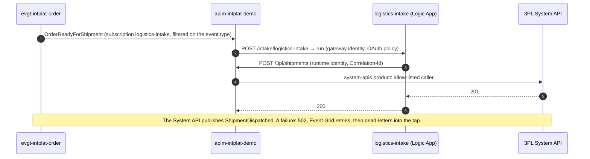
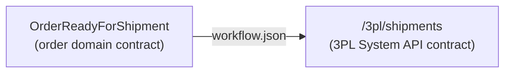

# logistics-intake

The **logistics domain's intake flow** ([ADR 0015](https://github.com/azure-intelligence-domain/ai-intelligence-domain/blob/main/docs/adr/0015-one-intake-per-domain.md)):
what the logistics domain takes in from other domains. A Logic App (Consumption), owned by the
**logistics-team**. It receives **OrderReadyForShipment** and asks the 3PL partner to ship, through the gateway, with the
3PL System API; the System API then publishes ShipmentDispatched.

| File | What |
|---|---|
| [`workflow.json`](workflow.json) | The flow: switch on the event type, map, call the System API |
| [`asyncapi.yaml`](asyncapi.yaml) | Consumer contract: what it receives (from the Order Process API's released contract) |
| [`infra/main.bicep`](infra/main.bicep) | The Logic App, its runtime identity, and its OAuth policy (the gateway only) |
| [`tests/`](tests/) | The flow against its contract |

## Mapping

The flow maps the order domain's event onto the 3PL System API's contract; nothing else.

## When a delivery fails

The flow does not retry: if the System API refuses or fails, the run ends in `502 Delivery
Failed`, Event Grid retries the delivery (3 attempts), then dead-letters the event into the tap
storage (`sttapintplatdemo`, container `deadletters`, folder `logistics-intake`). The Intelligence domain
sees it there; nobody has to search Logic App run histories.

## The v2.4 story (step 8)

This is the flow that breaks in the talk: version 2.4 changes the mapping to the partner's shipment
request, the 3PL System API (partner API 2.3, strict) refuses it with `400`, and every order ready
for shipment ends in the logistics domain's dead letters. The order stays `readyForShipment`;
nothing else notices, except the tap.

## Cost

Pay per run, nothing polls: an idle flow costs nothing. A run is about five built-in actions plus
one HTTP call.

## Pipeline

`.github/workflows/deploy.yml`: contract check and flow tests, then on `main` (OIDC as
`id-intplat-logistics-intake`): the Logic App, a smoke test (a call without the gateway's token gets `401`),
and a deployment event.
